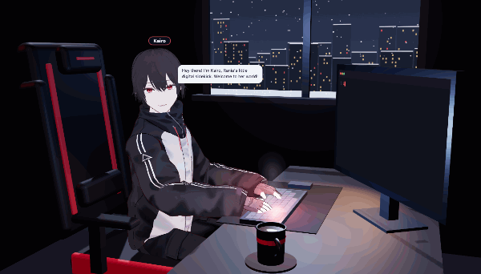

<div align="center">

# Kairo

**Born to conquer, wired to create.**

Rania's little digital sidekick, a 3D companion who codes through the night.



</div>

## Meet Kairo

His name means "the victorious one" in Arabic and "circuit" in Japanese.
He types at his desk, follows your cursor, takes the occasional stretch, and says hello when you click him.

## Run

```sh
npm start        # or: python3 serve.py
```

Opens at http://127.0.0.1:5180. Needs Python 3 and an internet connection.

## Make him yours

Edit his lines in [`kairo.json`](kairo.json). The first line plays on load, and each click shows the next.

Press **D** (or add `?debug` to the URL) for the debug panel.

## Credits

3D model: [AvatarSample_C](https://hub.vroid.com/characters/1248981995540129234/models/8640547963669442173) by VRoid Project, free to use and redistribute ([license](LICENSE-MODEL.md)).
Character, scene and code by Rania.
